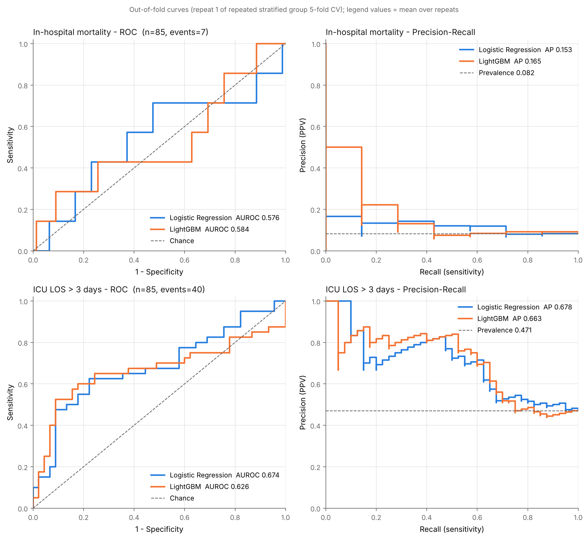
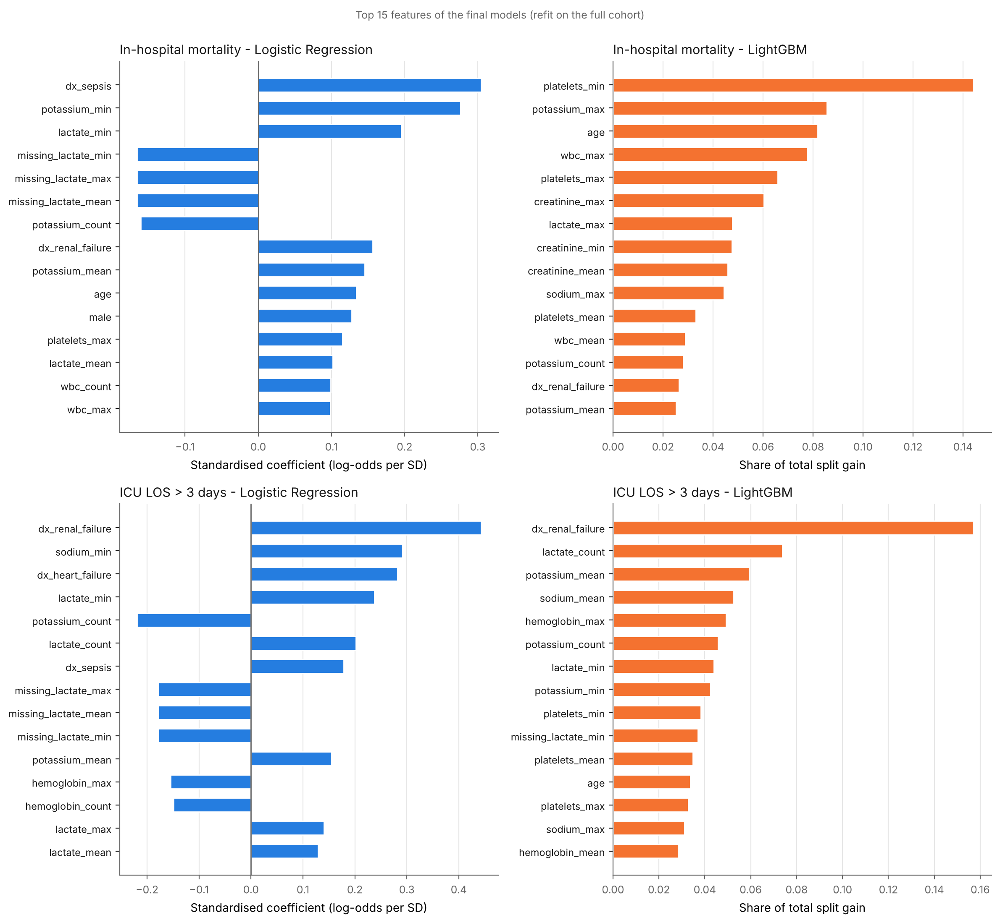
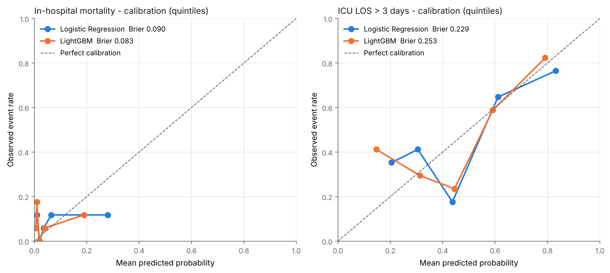

# First-24h ICU Risk Models on MIMIC-IV Demo v2.2

A reproducible pipeline that predicts **in-hospital mortality** and **prolonged ICU stay (> 3 days)** for adult ICU patients. It uses only data available in the **first 24 hours of the ICU stay** and is built on the open-access [MIMIC-IV Clinical Database Demo v2.2](https://physionet.org/content/mimic-iv-demo/2.2/) (PhysioNet, ODbL).

Running `src/download_data.py → src/cohort.py → src/train.py → pytest` takes under a minute. It produces every number and figure in this README, and the run is bit-for-bit identical inside Docker.

> **Read this first: sample size.** The demo has 100 patients. After exclusions the cohort is **85 stays with 7 deaths**. The pipeline is built to the standards of a full-scale study, but the estimates here are dominated by sampling noise. The mortality model in particular has **no demonstrable discrimination** (95% CI for AUROC crosses 0.5). Treat this repository as a validated, leakage-tested *method* that is ready to point at full MIMIC-IV (credentialed access). Do not treat it as a clinically usable model.

---

## 1. Clinical objective & study design

| Element | Definition |
|---|---|
| Design | Retrospective cohort, single centre (BIDMC), prediction model development with internal validation |
| Unit of analysis | One ICU stay per patient |
| Index time (t₀) | ICU admission (`icustays.intime`) |
| Prediction time | t₀ + 24 h |
| Outcome 1 | In-hospital mortality (`admissions.hospital_expire_flag`) |
| Outcome 2 | Prolonged ICU length of stay: `icustays.los` > 3 days |
| Predictors | Demographics, ICU type, ICD comorbidities, first-24h labs (below) |

### Cohort selection (`reports/cohort_flow.json`)

| Step | Stays | Patients |
|---|---:|---:|
| All ICU stays in demo | 140 | 100 |
| First ICU stay per patient (independence of observations) | 100 | 100 |
| Age ≥ 18 at ICU admission (`anchor_age + year(intime) − anchor_year`) | 100 | 100 |
| ICU LOS ≥ 24 h **and** alive at hour 24 | **85** | **85** |

The last exclusion matters. A model scored at hour 24 can only be applied to patients who are still in the ICU at hour 24. Keeping stays that end earlier would leak the outcome: very short stays are disproportionately early deaths or rapid discharges.

Final cohort: median age 63 (IQR 51–75), 54.1% male. **7 in-hospital deaths (8.2%)** and **40 prolonged stays (47.1%)**.

### Predictors (39 raw features → 42 after missingness indicators)

* **Demographics / context:** age, male sex, emergency/urgent admission, medical-type ICU (MICU, MICU/SICU, CCU) vs. surgical/cardiac/neuro.
* **First-24h labs:** min, max, mean and count of measurements for **creatinine, lactate, WBC, hemoglobin, sodium, potassium and platelets**. Only blood specimens are used, and blood-gas/whole-blood variants are pooled (itemids in `src/cohort.py::LAB_ITEMS`).
* **Comorbidity flags (ICD-9 and ICD-10 prefixes):** sepsis, renal failure, heart failure, diabetes, COPD, liver disease, malignancy.

### Leakage prevention

1. **Temporal:** a lab is used only if `intime ≤ charttime ≤ intime + 24h`. Labs are joined on `subject_id` + time (not `hadm_id`), so draws without a `hadm_id` are still windowed correctly. Every lab event actually used is written to `data/processed/lab_events_used.csv`. The tests check that every one falls inside the window and that every aggregated feature can be recomputed from that audit trail alone.
2. **Patient-level:** CV uses `StratifiedGroupKFold` with `groups=subject_id`, so no patient appears in both a training and a validation fold. The pipeline does this even though the cohort already has one stay per patient.
3. **Preprocessing:** imputation medians, scaling and model fitting live inside a single sklearn `Pipeline` that is re-fitted in every training fold.
4. **Thresholds:** the sensitivity/specificity cut-off is the *training-fold* prevalence, chosen without looking at validation labels.
5. **No outcome-adjacent columns:** LOS, outtime, dischtime, deathtime, discharge location and dod are never features (tested).
6. **Known limitation, ICD codes:** MIMIC diagnoses are coded at discharge. Chronic conditions (HF, CKD, diabetes, COPD, liver disease, cancer) are almost always pre-existing, and using them follows standard Elixhauser-style risk adjustment. Acute codes such as *sepsis* may partly reflect the ICU course, however. The [sensitivity analysis](#sensitivity-analysis-no-icd-features) re-runs everything without ICD features.

### Informative clinical missingness

Missing labs are rarely missing at random. A lactate is ordered when a clinician suspects hypoperfusion, and in this cohort **34.1% of stays have no lactate in the first 24 h** (all other labs are complete). The pipeline therefore uses:

* **median imputation**, with the median learned on the training fold only, plus
* a **binary missingness indicator** for every feature with missing values (`SimpleImputer(add_indicator=True)`).

This keeps the logistic regression interpretable: a coefficient on `missing_lactate_*` reads directly as "lactate not ordered". It also lets both models exploit the signal in ordering behaviour without the opacity of model-native NaN handling. The indicator does carry signal: in the fitted models, *not* having a lactate drawn is associated with lower risk for both outcomes (see feature importance).

### Models & validation

| | Logistic Regression (baseline) | LightGBM |
|---|---|---|
| Preprocessing | median impute + indicators → standardise | median impute + indicators |
| Hyper-parameters | L2, C = 0.1 | 200 trees, lr 0.03, depth 2, 4 leaves, min_child_samples 5, row/col subsampling 0.8/0.7, λ = 1 |

The hyper-parameters were fixed *a priori* for a very small sample and were not tuned on the CV results.

* **Repeated stratified group 5-fold CV, 20 repeats.** Metrics are computed on the pooled out-of-fold predictions of each repeat, because a single fold holds only 1–2 deaths. They are reported as mean ± SD across repeats.
* **95% CI:** percentile bootstrap (1,000 resamples) of the repeat-1 out-of-fold predictions.
* **Final model:** each candidate is refitted on the full cohort, and the one with the higher mean CV AUROC is saved per outcome.

---

## 2. Results (real run; source: [`reports/metrics.json`](reports/metrics.json))

Values are the mean ± SD over 20 CV repeats, with the bootstrap 95% CI in brackets. **Bold** marks the model selected for each outcome.

### In-hospital mortality (n = 85, 7 events, prevalence 8.2%)

| Model | AUROC | PR-AUC (AP) | Brier ↓ | Sensitivity | Specificity |
|---|---|---|---|---|---|
| Logistic Regression | 0.576 ± 0.076 [0.264, 0.813] | 0.152 ± 0.046 [0.042, 0.328] | 0.090 ± 0.007 | 0.407 ± 0.141 | 0.769 ± 0.020 |
| **LightGBM** | 0.584 ± 0.070 [0.256, 0.802] | 0.165 ± 0.058 [0.039, 0.511] | 0.083 ± 0.006 | 0.243 ± 0.123 | 0.867 ± 0.027 |
| *No-skill reference* | 0.500 | 0.082 | 0.076 | – | – |

### ICU length of stay > 3 days (n = 85, 40 events, prevalence 47.1%)

| Model | AUROC | PR-AUC (AP) | Brier ↓ | Sensitivity | Specificity |
|---|---|---|---|---|---|
| **Logistic Regression** | 0.674 ± 0.023 [0.568, 0.798] | 0.678 ± 0.028 [0.565, 0.838] | 0.229 ± 0.010 | 0.615 ± 0.034 | 0.691 ± 0.029 |
| LightGBM | 0.626 ± 0.033 [0.541, 0.790] | 0.663 ± 0.040 [0.577, 0.845] | 0.253 ± 0.014 | 0.585 ± 0.047 | 0.646 ± 0.065 |
| *No-skill reference* | 0.500 | 0.471 | 0.249 | – | – |

PPV, NPV and the bootstrap CIs for every metric are in `metrics.json`.

**Interpretation**

* **Prolonged LOS:** the logistic regression baseline discriminates modestly but genuinely (AUROC 0.67, CI excludes 0.5). It is better calibrated than predicting the base rate (Brier 0.229 vs 0.249). The leading predictors are clinically plausible: renal failure, heart failure, sepsis, admission sodium/lactate, and whether a lactate was ordered at all. LightGBM does not beat the baseline at n = 85, which is the expected result for boosted trees on fewer than 100 rows.
* **Mortality:** with 7 events neither model shows reliable discrimination (CIs span 0.26–0.81). Both models score a *worse* Brier than a constant prediction of the prevalence (0.083–0.090 vs 0.076). This is the honest answer from the data. Roughly 10–20 events per candidate predictor are needed, which means full MIMIC-IV (~70k ICU stays) rather than the demo. LightGBM was "selected" on the point estimate only, and that difference is noise.

### Sensitivity analysis (no ICD features)

Results with labs + demographics only (10 repeats, mean pooled-OOF AUROC / Brier):

| Outcome | Logistic Regression | LightGBM |
|---|---|---|
| Mortality | 0.565 / 0.092 | 0.604 / 0.080 |
| Prolonged LOS | 0.636 / 0.243 | 0.589 / 0.267 |

Dropping the discharge-coded comorbidities costs about 0.04 AUROC for LOS. Part of the LOS signal therefore comes from ICD codes, which should be replaced by pre-admission history (prior-admission codes) before any prospective use.

### Figures

**ROC and precision–recall curves** (out-of-fold, LR vs LightGBM, both outcomes)



**Feature importance** of the final models: standardised LR coefficients (signed, log-odds per SD) and LightGBM share of split gain



**Calibration** (out-of-fold, quintile bins). This figure is supplementary.



---

## 3. Repository layout

```
.
├── Dockerfile                 # download → cohort → train → pytest, end-to-end
├── requirements.txt           # pinned dependency versions
├── README.md
├── src/
│   ├── download_data.py       # fetch 6 MIMIC-IV Demo v2.2 tables, SHA-256 verified
│   ├── cohort.py              # exclusions, first-24h lab aggregation, ICD flags, outcomes
│   └── train.py               # LR vs LightGBM, repeated group CV, metrics, plots, model bundle
├── tests/
│   └── test_pipeline.py       # leakage (patient & temporal) and inference tests
├── reports/                   # tracked outputs of the real run
│   ├── metrics.json
│   ├── cohort_flow.json
│   ├── roc_pr_curves.png
│   ├── feature_importance.png
│   └── calibration.png
├── models/
│   └── model_pipeline.joblib  # fitted sklearn pipelines (one per outcome) + metadata
└── data/                      # git-ignored; recreated by the scripts
    ├── raw/{hosp,icu}/*.csv.gz
    └── processed/{cohort.csv, lab_events_used.csv}
```

## 4. Running it

### Locally (Python 3.13)

```bash
python -m venv .venv && source .venv/bin/activate
```

```bash
pip install -r requirements.txt
```

```bash
python src/download_data.py
```

```bash
python src/cohort.py
```

```bash
python src/train.py
```

```bash
python -m pytest -v
```

`train.py` accepts `--folds`, `--repeats` and `--bootstrap`. `download_data.py` skips files that are already downloaded and verified, and accepts `--force` to fetch them again.

### Docker

```bash
docker build -t mimic-icu-risk .
```

```bash
docker run --rm -v "$PWD/reports:/app/reports" -v "$PWD/models:/app/models" mimic-icu-risk
```

The container downloads the data, builds the cohort, trains and evaluates the models, and runs the tests. It exits non-zero if any step fails. If Docker Hub rate-limits you, point the build at a mirror of the same official image:

```bash
docker build --build-arg BASE_IMAGE=mirror.gcr.io/library/python:3.13-slim -t mimic-icu-risk .
```

### Using the saved model

```python
import joblib, pandas as pd
bundle = joblib.load("models/model_pipeline.joblib")
X = pd.read_csv("data/processed/cohort.csv")[bundle["features"]].to_numpy(float)
p_los = bundle["targets"]["prolonged_los"]["model"].predict_proba(X)[:, 1]
flag  = p_los >= bundle["targets"]["prolonged_los"]["threshold"]
```

Missing values (`NaN`) are allowed in any feature. They are imputed, and the missingness indicators are set.

## 5. Tests

`tests/test_pipeline.py` runs 10 tests. Each one checks the real artefacts and, where possible, also checks hand-built data where the correct answer is known.

1. **No `subject_id` leakage:** fold subject sets are disjoint. This is checked on a synthetic cohort with 1–4 stays per patient and on the real cohort for both outcomes across 10 seeds.
2. **First-24h only:**
   * Hand-built labs at −2 h, 0 h, 12 h, 24 h and 30 h: only 0–24 h are aggregated.
   * Stays that end before hour 24 or die before hour 24 are excluded, as are minors.
   * Every real audited lab lies in `[intime, intime+24h]`, and all features can be recomputed from that audit trail.
   * No outcome or post-window columns are features.
3. **Valid probabilities:** both pipeline types, and the saved bundle on sample real records (including records with many injected `NaN`s), return finite probabilities in [0, 1].

## 6. Limitations

* Tiny sample (85 stays, 7 deaths). The CIs are wide and the mortality results are not informative.
* Single centre, with internal validation only. External or temporal validation is required.
* ICD comorbidities are discharge-coded (see the sensitivity analysis).
* Only 7 labs are used. Vitals (`icu/chartevents`), severity scores (SOFA/APACHE), interventions and medications are not included.
* MIMIC-IV dates are shifted per patient, so calendar-time trends cannot be studied.

## Data licence & citation

The MIMIC-IV Demo is released under the Open Data Commons Open Database License (ODbL). The data are **not** redistributed here. They are downloaded at run time from PhysioNet.

> Johnson, A., Bulgarelli, L., Pollard, T., Horng, S., Celi, L. A., & Mark, R. (2023). MIMIC-IV Clinical Database Demo (version 2.2). PhysioNet. https://doi.org/10.13026/dp1f-ex47
>
> Goldberger, A., et al. (2000). PhysioBank, PhysioToolkit, and PhysioNet. *Circulation*, 101(23), e215–e220.
